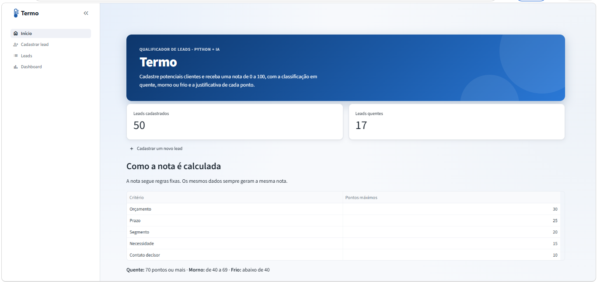
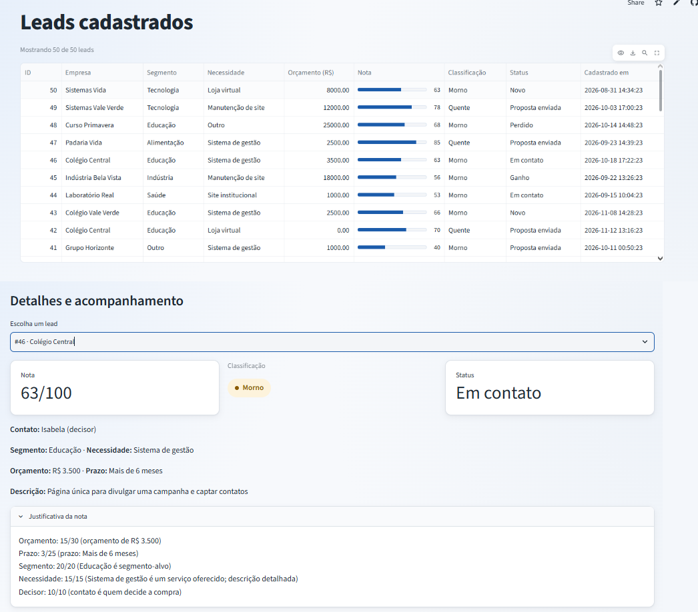
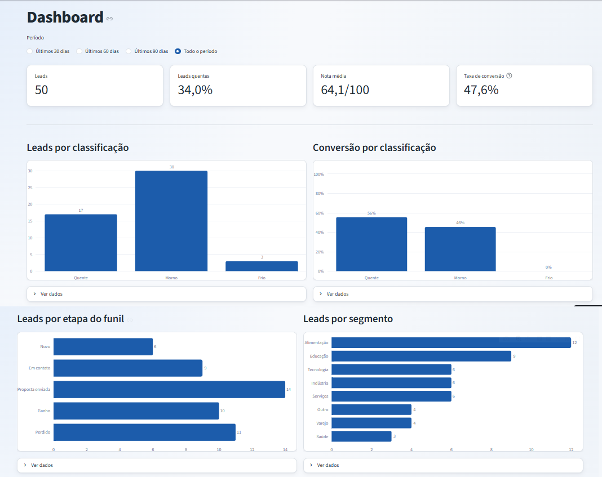

# Termo

Qualificador de leads em Python. O app recebe os dados de um potencial cliente, calcula uma nota de 0 a 100 por regras fixas, classifica o lead em quente, morno ou frio e usa a IA do Google (Gemini) para comentar o caso.

App publicado: **https://termo-leads.streamlit.app**



> A versão publicada usa apenas dados fictícios. Não digite dados reais de pessoas ou empresas.

## O que o app faz

O cenário é o de uma empresa que vende criação de sites e sistemas para pequenas e médias empresas. Cada lead cadastrado passa por quatro etapas: validação dos campos, cálculo da nota, análise da IA e gravação no banco de dados.

O app tem quatro páginas:

- Início: resumo dos leads e explicação das regras de pontuação.
- Cadastrar lead: formulário com validação. Ao enviar, mostra a nota, a classificação, a justificativa de cada ponto e a análise da IA.
- Leads: tabela com filtros por empresa, classificação, segmento e status, detalhes de cada lead, troca de status no funil de vendas e exclusão.
- Dashboard: indicadores e gráficos com filtro de período.

O app não envia mensagens a clientes. O acompanhamento do funil é feito à mão.

## Como a nota é calculada

A nota é a soma de cinco critérios. Os pesos e as faixas ficam em `src/criterios.py`, separados da lógica de cálculo.

| Critério | Pontos máximos | Como pontua |
|---|---|---|
| Orçamento | 30 | por faixa de valor, de R$ 0 (0 ponto) a R$ 15.000 ou mais (30 pontos) |
| Prazo para começar | 25 | quanto mais urgente, mais pontos |
| Segmento | 20 | 20 para segmento-alvo, 10 para secundário, 0 para os demais |
| Necessidade | 15 | 10 se o pedido é um serviço oferecido e 5 se a descrição tem pelo menos 30 caracteres |
| Contato decisor | 10 | 10 se o contato decide a compra, 3 se não decide |

Com 70 pontos ou mais o lead é quente, de 40 a 69 é morno e abaixo de 40 é frio. A justificativa mostra a conta item por item, por exemplo `Orçamento: 25/30 (orçamento de R$ 12.000)`.

## Papel da IA

A IA não decide a nota. Ela recebe os dados do lead junto com a nota já calculada e devolve um resumo, pontos fortes, riscos, uma próxima ação para o vendedor e um alerta quando encontra uma inconsistência. Um exemplo de alerta: um lead que pede uma loja virtual com 200 produtos e cálculo de frete, com orçamento de R$ 1.500.

A resposta vem em JSON e passa por validação antes de ser usada. Se a IA falhar (sem internet, chave inválida, limite de uso atingido ou resposta fora do formato), o lead é salvo com a nota e o app mostra um aviso. Sem chave de API, o app usa uma análise de exemplo, o que permite testar o projeto sem criar conta no Google.

## Tecnologias

- Python 3.13
- Streamlit (interface)
- SQLite (banco de dados)
- Pandas (cálculos do dashboard)
- Plotly (gráficos)
- Google Gemini, pela biblioteca `google-genai` (análise complementar)
- Pytest (testes automáticos)
- Git e GitHub (versionamento) e Streamlit Community Cloud (publicação)

## Estrutura do projeto

```
qualificador-leads/
├── app.py                  # ponto de entrada: menu, estilo e dados de demonstração
├── inicio.py               # página inicial
├── pages/
│   ├── 1_Cadastrar_Lead.py
│   ├── 2_Leads.py
│   └── 3_Dashboard.py
├── src/
│   ├── models.py           # estrutura de um lead e etapas do funil
│   ├── criterios.py        # pesos e faixas da pontuação
│   ├── scoring.py          # cálculo da nota e da justificativa
│   ├── ai_analyzer.py      # integração com o Gemini e modo simulado
│   ├── database.py         # acesso ao SQLite
│   ├── metricas.py         # cálculos do dashboard
│   ├── config.py           # leitura da chave e do modelo
│   ├── estilo.py           # aplica o CSS
│   └── componentes.py      # banner e selos de classificação
├── scripts/
│   ├── gerar_dados_ficticios.py
│   └── testar_ia.py
├── tests/                  # 34 testes com Pytest
├── assets/                 # logo e CSS
└── .streamlit/config.toml  # tema
```

## Como rodar no seu computador

Pré-requisitos: Python 3.13 e Git.

```powershell
git clone https://github.com/viniciusab12/qualificador-leads.git
cd qualificador-leads
py -3.13 -m venv .venv
.venv\Scripts\Activate.ps1
pip install -r requirements.txt
```

No macOS ou Linux, ative o ambiente com `source .venv/bin/activate`.

Para usar a IA, copie o arquivo `.env.example` para `.env` e coloque a sua chave, criada no [Google AI Studio](https://aistudio.google.com/apikey). Sem o `.env`, o app funciona em modo simulado.

```powershell
streamlit run app.py
```

Na primeira execução o banco vem vazio e o app cadastra 50 leads fictícios. Para recriar esses dados:

```powershell
python -m scripts.gerar_dados_ficticios --limpar
```

## Testes

```powershell
pytest -v
```

São 34 testes. Eles cobrem o banco de dados (incluindo o desfazer de uma operação que falha no meio), as regras de pontuação com os casos de borda de cada faixa, a integração com a IA e os cálculos do dashboard. Os testes da IA trocam a chamada à API por respostas simuladas, então não gastam cota nem precisam de internet.

## Decisões técnicas

A nota fica com regras em Python porque precisa ser repetível e explicável: os mesmos dados sempre geram a mesma nota, e cada ponto aparece na justificativa. A IA entra onde regras fixas não alcançam, que é a leitura da descrição em texto livre.

As consultas ao banco usam parâmetros (`?`) em vez de juntar textos, o que impede SQL injection. As conexões abrem e fecham por um gerenciador de contexto que desfaz a operação em caso de erro.

A chamada à API do Gemini fica isolada numa função própria. Com isso os testes conseguem substituí-la por uma resposta pronta e cobrir os cenários de erro.

A chave da API fica no arquivo `.env`, que o `.gitignore` mantém fora do repositório. Na versão publicada ela fica nos Secrets do Streamlit Community Cloud.

Os cálculos do dashboard ficam em `src/metricas.py`, separados das telas, para serem testados sem abrir o navegador.

## O que faltaria para uso em produção

- Login e separação dos dados por cliente.
- Critérios de pontuação configuráveis por empresa, em vez de fixos no código.
- Banco de dados em nuvem com backup, já que o SQLite da versão publicada volta ao estado inicial quando o app reinicia.
- Camada paga da API do Gemini, porque na camada gratuita o conteúdo enviado pode ser usado pelo Google para melhorar os produtos.
- Entrada automática de leads por formulário público ou integração com outros sistemas.

## Telas

Cadastro com resultado da qualificação:


Consulta e acompanhamento:



Dashboard:



## Autor

Vinícius Abreu Queiroz Felicio, estudante de Engenharia Eletrônica e de Telecomunicações na Universidade Federal de Uberlândia (UFU).

GitHub: [viniciusab12](https://github.com/viniciusab12)

## Licença

Distribuído sob a licença MIT. Veja o arquivo [LICENSE](LICENSE).
