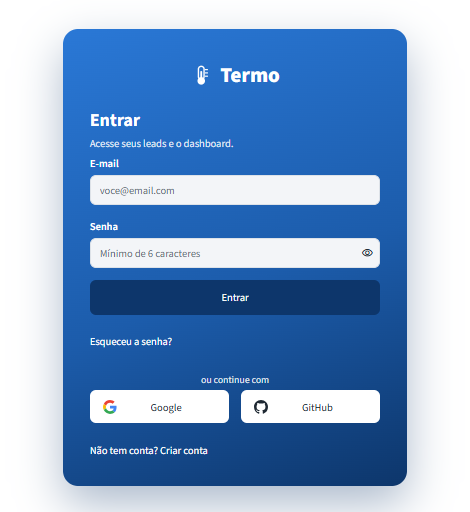
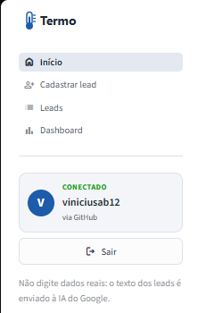
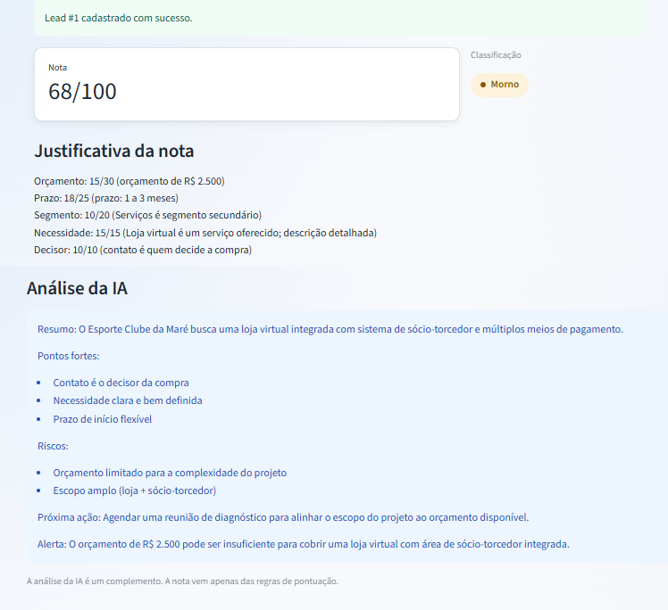

# Termo

Qualificador de leads em Python. O app recebe os dados de um potencial cliente, calcula uma nota de 0 a 100 por regras fixas, classifica o lead em quente, morno ou frio e usa a IA do Google (Gemini) para comentar o caso.

App publicado: **https://termo-leads.streamlit.app**


> Use apenas dados fictícios. Não digite dados reais de pessoas ou empresas.

## Acesso

O app abre em modo demonstração, sem login, com 50 leads fictícios. Esses leads ficam num SQLite que o app só lê. O que cada visitante cadastra, altera ou exclui fica guardado na sessão dele e some quando a aba fecha, então um visitante não vê nem apaga o que outro fez. No modo demonstração, cada visitante tem 3 análises reais da IA; depois disso o app usa uma análise de exemplo.

Quem cria uma conta passa a ter os próprios leads, salvos no Supabase (PostgreSQL) e visíveis só para essa conta. Há três formas de entrar:

- e-mail e senha, com confirmação por e-mail e recuperação de senha por código de 6 dígitos;
- conta Google;
- conta GitHub, por meio do Auth0.

Senhas novas precisam de pelo menos 8 caracteres, e 5 senhas erradas seguidas bloqueiam o login por 5 minutos naquela sessão. A sessão continua ativa por 14 dias depois de fechar a aba, num cookie enviado só por HTTPS. Ao clicar em Sair, o app encerra a sessão daquele navegador no Supabase e apaga o cookie. A barra lateral mostra a conta logada e por qual forma ela entrou.

A política de privacidade está em [PRIVACIDADE.md](PRIVACIDADE.md).

## O que o app faz

O cenário é o de uma empresa que vende criação de sites e sistemas para pequenas e médias empresas. Cada lead cadastrado passa por quatro etapas: validação dos campos, cálculo da nota, análise da IA e gravação no banco de dados.

O app tem seis páginas, além da tela de login:

- Início: resumo dos leads, lista dos leads para contatar hoje e as regras de pontuação em uso.
- Cadastrar lead: formulário com validação. Ao enviar, mostra a nota, a classificação, a justificativa de cada ponto e a análise da IA.
- Leads: tabela com filtros e exportação em CSV, detalhes de cada lead, troca de status no funil, data do próximo contato, histórico de anotações, edição dos dados (com a nota recalculada) e exclusão.
- Dashboard: indicadores e gráficos com filtro de período.
- Critérios: pesos de cada critério, limites de classificação, segmentos-alvo e tamanho mínimo da descrição, com prévia da nota antes de salvar.
- Minha conta: exportação de todos os leads e exclusão da conta e dos dados.

O app não envia mensagens a clientes. O acompanhamento do funil é feito à mão.

## Como a nota é calculada

A nota é a soma de cinco critérios. As regras padrão ficam em `src/criterios.py`, separadas da lógica de cálculo em `src/scoring.py`.

| Critério | Pontos máximos | Como pontua |
|---|---|---|
| Orçamento | 30 | por faixa de valor, de R$ 0 (0 ponto) a R$ 15.000 ou mais (30 pontos) |
| Prazo para começar | 25 | quanto mais urgente, mais pontos |
| Segmento | 20 | 20 para segmento-alvo, 10 para secundário, 0 para os demais |
| Necessidade | 15 | 10 se o pedido é um serviço oferecido e 5 se a descrição tem pelo menos 30 caracteres |
| Contato decisor | 10 | 10 se o contato decide a compra, 3 se não decide |

Com 70 pontos ou mais o lead é quente, de 40 a 69 é morno e abaixo de 40 é frio. A justificativa mostra a conta item por item, por exemplo `Orçamento: 25/30 (orçamento de R$ 12.000)`.

### Regras por conta

Na página Critérios, cada conta muda o peso dos critérios (a soma precisa dar 100), os limites de quente e morno, os segmentos-alvo e secundários e o tamanho mínimo da descrição. O peso é a pontuação máxima do critério, e os pontos de cada faixa mudam na mesma proporção: com o peso de Orçamento em 40, a faixa que valia 15 de 30 passa a valer 20 de 40.

Cada alteração é salva como uma versão nova (1, 2, 3...), e cada lead guarda a versão usada na nota. Mudar as regras não altera os leads antigos. Para aplicar as regras novas neles, existe o botão Recalcular todos os leads. A configuração passa por validação em Python antes de ser salva, e a IA não participa de nenhuma parte da pontuação.

## Papel da IA

A IA não decide a nota. Ela recebe os dados do lead junto com a nota já calculada e devolve um resumo, pontos fortes, riscos, uma próxima ação para o vendedor e um alerta quando encontra uma inconsistência. Um exemplo de alerta: um lead que pede uma loja virtual com 200 produtos e cálculo de frete, com orçamento de R$ 1.500.

A resposta vem em JSON e passa por validação antes de ser usada. Se a IA falhar (sem internet, chave inválida, limite de uso atingido ou resposta fora do formato), o lead é salvo com a nota e o app mostra um aviso. Sem chave de API, o app usa uma análise de exemplo, o que permite testar o projeto sem criar conta no Google.

## Tecnologias

- Python 3.13
- Streamlit (interface)
- SQLite (banco do modo demonstração)
- Supabase: PostgreSQL para os leads de cada conta e autenticação por e-mail e senha
- Login com Google e GitHub pelo `st.login` do Streamlit (OpenID Connect), com o Auth0 como intermediário para o GitHub
- Pandas (cálculos do dashboard)
- Plotly (gráficos)
- Google Gemini, pela biblioteca `google-genai` (análise complementar)
- Pytest (testes automáticos)
- Git e GitHub (versionamento) e Streamlit Community Cloud (publicação)

## Estrutura do projeto

```
qualificador-leads/
├── app.py                  # ponto de entrada: menu, sessão, card da conta e dados de demonstração
├── inicio.py               # página inicial
├── pages/
│   ├── 0_Entrar.py         # login, criação de conta e recuperação de senha
│   ├── 1_Cadastrar_Lead.py
│   ├── 2_Leads.py
│   ├── 3_Dashboard.py
│   ├── 4_Criterios.py      # regras de pontuação da conta
│   └── 5_Conta.py          # exportar dados e excluir a conta
├── src/
│   ├── models.py           # estrutura de um lead e etapas do funil
│   ├── criterios.py        # regras padrão e validação das regras de cada conta
│   ├── scoring.py          # cálculo da nota e da justificativa
│   ├── ai_analyzer.py      # integração com o Gemini e modo simulado
│   ├── database.py         # acesso ao SQLite (modo demonstração)
│   ├── supabase_db.py      # acesso aos leads de cada conta no Supabase
│   ├── dados.py            # escolhe o banco conforme o usuário está logado ou não
│   ├── auth.py             # login, cadastro, recuperação de senha e sessão
│   ├── cookies.py          # cookie que mantém a sessão depois de fechar a aba
│   ├── metricas.py         # cálculos do dashboard
│   ├── config.py           # leitura das chaves do Gemini e do Supabase
│   ├── estilo.py           # aplica o CSS
│   └── componentes.py      # banner e selos de classificação
├── scripts/
│   ├── gerar_dados_ficticios.py
│   └── testar_ia.py
├── tests/                  # 132 testes com Pytest
├── supabase/schema.sql     # tabela, RLS e permissões do Supabase
├── assets/                 # logo e CSS
├── .streamlit/config.toml  # tema
└── PRIVACIDADE.md          # política de privacidade
```

## Como rodar no seu computador

Pré-requisitos: Python 3.13 e Git.

```powershell
git clone https://github.com/viniciusab12/qualificador-leads.git
cd qualificador-leads
py -3.13 -m venv .venv
.venv\Scripts\Activate.ps1
pip install -r requirements.txt
```

No macOS ou Linux, ative o ambiente com `source .venv/bin/activate`.

Para usar a IA, copie o arquivo `.env.example` para `.env` e coloque a sua chave, criada no [Google AI Studio](https://aistudio.google.com/apikey). Sem a chave, o app funciona com uma análise de exemplo.

O login é opcional. Sem configuração, o app roda só no modo demonstração. Para ativá-lo:

- E-mail e senha: crie um projeto no [Supabase](https://supabase.com), rode o arquivo `supabase/schema.sql` no SQL Editor e preencha `SUPABASE_URL`, `SUPABASE_ANON_KEY` e `SUPABASE_SERVICE_KEY` no `.env`.
- Google e GitHub: crie o arquivo `.streamlit/secrets.toml` com os blocos `[auth]`, `[auth.google]` e `[auth.github]`, seguindo a [documentação do `st.login`](https://docs.streamlit.io/develop/concepts/connections/authentication). O GitHub não usa OpenID Connect, por isso o login passa por um aplicativo do Auth0 com a conexão GitHub ativada.

O `.env` e o `secrets.toml` estão no `.gitignore` e nunca devem ir para o repositório.

```powershell
streamlit run app.py
```

Na primeira execução o banco vem vazio e o app cadastra 50 leads fictícios. Para recriar esses dados:

```powershell
python -m scripts.gerar_dados_ficticios --limpar
```

## Testes

```powershell
pytest -v
```

São 132 testes. Eles cobrem o banco de dados (incluindo o desfazer de uma operação que falha no meio), as regras de pontuação com os casos de borda de cada faixa, a validação e o versionamento das regras de cada conta, a edição, as anotações, o próximo contato, a exportação em CSV, a exclusão da conta, a integração com a IA, os cálculos do dashboard, a validação de login e a tradução das mensagens de erro, a escolha entre SQLite e Supabase, o isolamento entre contas e entre visitantes da demonstração, o limite de tentativas de login e a proteção do prompt da IA contra instruções escritas nos dados do lead. Os testes da IA e do Supabase trocam as chamadas externas por respostas simuladas, então não gastam cota nem precisam de internet.

## Decisões técnicas

A nota fica com regras em Python porque precisa ser repetível e explicável: os mesmos dados sempre geram a mesma nota, e cada ponto aparece na justificativa. A IA entra onde regras fixas não alcançam, que é a leitura da descrição em texto livre.

As consultas ao banco usam parâmetros (`?`) em vez de juntar textos, o que impede SQL injection. As conexões abrem e fecham por um gerenciador de contexto que desfaz a operação em caso de erro.

A chamada à API do Gemini fica isolada numa função própria. Com isso os testes conseguem substituí-la por uma resposta pronta e cobrir os cenários de erro.

As chaves ficam no arquivo `.env` e no `.streamlit/secrets.toml`, que o `.gitignore` mantém fora do repositório. Na versão publicada elas ficam nos Secrets do Streamlit Community Cloud.

Cada lead salvo no Supabase guarda o dono da conta: o e-mail verificado (e-mail e senha ou Google) ou o identificador fixo da conta GitHub. Toda consulta filtra por esse dono. O app acessa o banco com a chave de serviço, que fica só no servidor e ignora o RLS. Por isso o filtro é conferido por testes que usam um banco falso: eles falham se alguma operação rodar sem o filtro ou se uma conta conseguir ler, alterar ou excluir o lead de outra. A tabela tem RLS ligado e nenhuma política para a chave pública, que não consegue acessar os leads. A configuração está em `supabase/schema.sql`.

O cookie de sessão guarda apenas o refresh token do Supabase, não a senha. Ao sair, o token é revogado no Supabase.

Os e-mails de confirmação e de recuperação de senha saem de uma conta Gmail criada só para o app, com senha de app, e não de uma conta pessoal.

Os cálculos do dashboard ficam em `src/metricas.py`, separados das telas, para serem testados sem abrir o navegador.

## O que faltaria para uso em produção

- Criar critérios novos (por exemplo, número de funcionários), além de ajustar os cinco que existem.
- Backup automático do banco, que a camada gratuita do Supabase não oferece.
- Domínio próprio para os e-mails, no lugar de uma conta Gmail.
- Camada paga da API do Gemini, porque na camada gratuita o conteúdo enviado pode ser usado pelo Google para melhorar os produtos.
- Entrada automática de leads por formulário público ou integração com outros sistemas.

## Telas

Tela de login:



Card da conta na barra lateral:



Cadastro com resultado da qualificação:



Consulta e acompanhamento:


Dashboard:


## Autor

Vinícius Abreu Queiroz Felicio, estudante de Engenharia Eletrônica e de Telecomunicações na Universidade Federal de Uberlândia (UFU).

GitHub: [viniciusab12](https://github.com/viniciusab12)

## Licença

Distribuído sob a licença MIT. Veja o arquivo [LICENSE](LICENSE).
